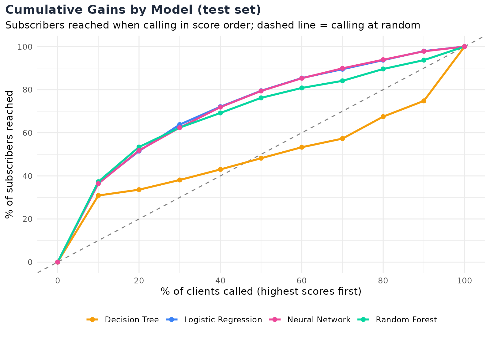
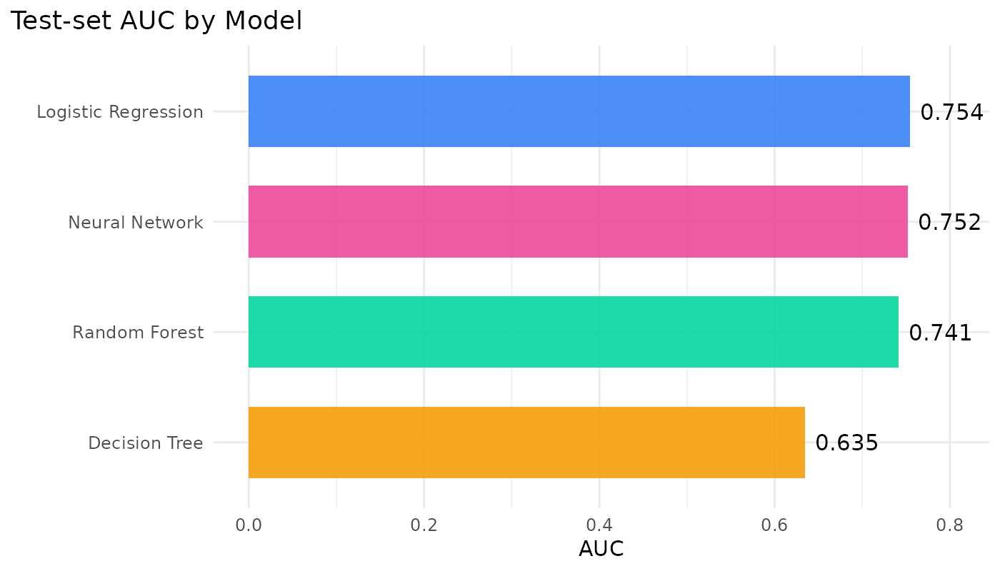
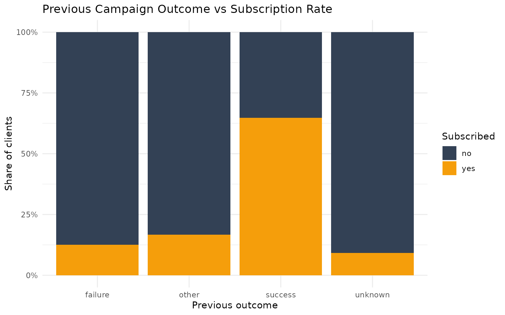
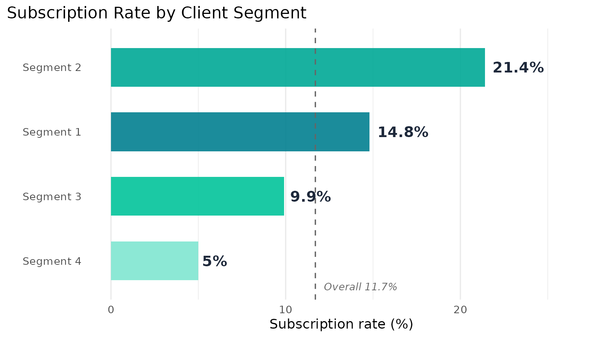
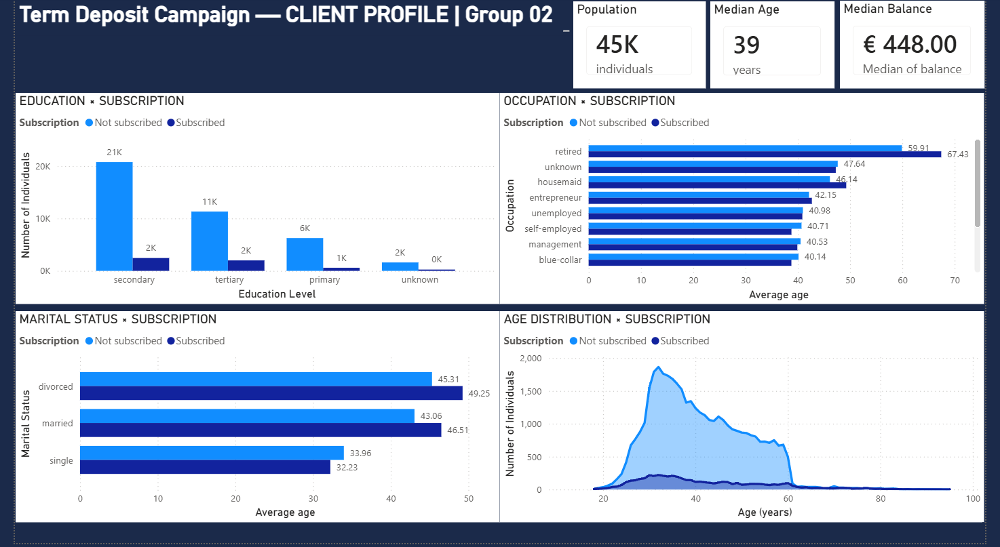
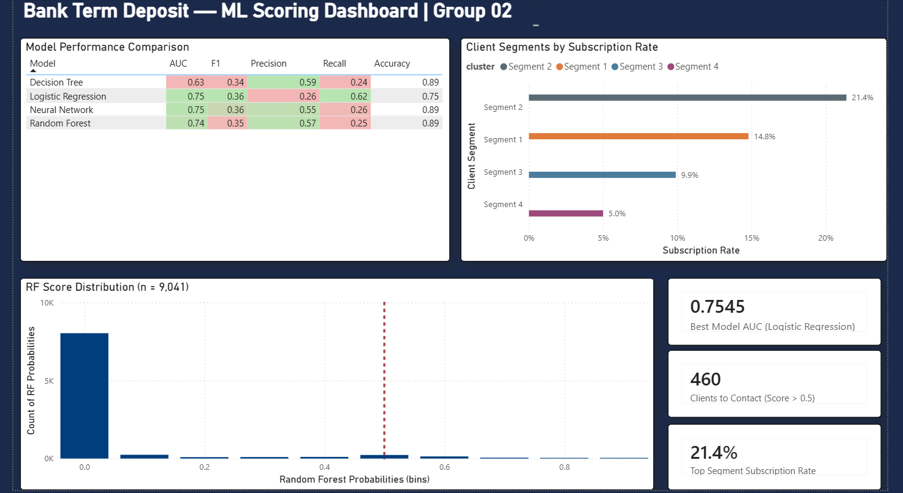

# Who Should the Bank Call? Predicting Term Deposit Subscriptions


## Business Problem

A Portuguese retail bank sells term deposits through outbound phone campaigns. Only about 1 in 9 contacted clients subscribes (11.7% of 45,211), so most calls cost agent time and client goodwill without producing a sale.

The bank has no way to rank clients before a campaign starts. This project asks whether the information the bank already holds about a client (demographics, account position and contact history) is enough to decide who is worth calling first.

Findings are directional and based on historical data from 2008 to 2010. See [Limitations](#limitations) before relying on any figure.


## Project Objective

Build and compare classification models that score each client's likelihood of subscribing **before the call is made**, and turn the scores and client segments into a calling strategy a marketing team can act on.


## Dataset

**Source:** [UCI Machine Learning Repository: Bank Marketing](https://archive.ics.uci.edu/dataset/222/bank+marketing) (Moro, Rita and Cortez, 2014)

- 45,211 client contacts from a Portuguese bank's phone campaigns, May 2008 to November 2010
- 16 input variables: age, job, marital status, education, credit default, balance, housing and personal loans, contact type and date, number of contacts, and outcome of the previous campaign
- Target: `y`, whether the client subscribed to a term deposit (yes / no)
- Imbalanced: 88.3% no, 11.7% yes

> **Note:** The raw file (`bank-full.csv`) is not included in this repository. Download it from the UCI link above and place it in `data/` before running the pipeline. See [`data/README.md`](data/README.md).


## Analytical Approach

The project follows the CRISP-DM process.

1. **Business and data understanding:** class balance and exploratory charts of subscription rate by job, month, age, balance, previous campaign outcome and number of calls
2. **Data preparation:** `duration` is removed because call length is only known after the call, so it cannot inform who to call. `pdays = -1` is converted into a `previously_contacted` flag. Outliers are capped at the 1st and 99th percentiles, categorical fields are one-hot encoded and all inputs are standardised
3. **Modelling:** four classifiers trained with 10-fold cross-validation and tuned on AUC: Logistic Regression, Decision Tree, Random Forest and a single-layer Neural Network
4. **Evaluation:** models are compared on a held-out 20% test set of 9,041 real clients using AUC, precision, recall and F1, with per-fold variance, confusion matrices, a threshold sweep and cumulative gains
5. **Segmentation and dimensionality reduction:** k-means clustering (k = 4) to profile client segments, and PCA to measure how compressible the feature space is
6. **Deployment view:** a Power BI dashboard presenting client profiles, model performance and segment subscription rates

**How leakage is avoided.** The train/test split happens first. Outlier caps and scaling are learned from the training set only. Class balancing (ROSE) runs inside each cross-validation fold, so every validation fold and the test set contain real clients only. The calling cutoff is chosen on cross-validation predictions and checked once on the test set.


## Key Findings

**A model can rank clients well enough to cut wasted calls.**
Calling clients in score order, the top 10% of scores convert at about 43%, against 11.7% overall (a lift of 3.7). The top 20% of scores contain roughly half of all subscribers: 51.5% with Logistic Regression and 53.4% with Random Forest.



**The simplest model is as good as the complex ones.**
Logistic Regression has the highest test AUC (0.755), ahead of the Neural Network (0.752) and Random Forest (0.741). It is also the most consistent of the three across the 10 cross-validation folds (standard deviation 0.010, against 0.012 and 0.018). The Decision Tree is clearly weaker (0.635).

| Model | AUC | Accuracy | Precision | Recall | F1 |
|---|---|---|---|---|---|
| Logistic Regression | 0.755 | 0.747 | 0.257 | 0.616 | 0.362 |
| Neural Network | 0.752 | 0.888 | 0.547 | 0.265 | 0.357 |
| Random Forest | 0.741 | 0.890 | 0.568 | 0.248 | 0.345 |
| Decision Tree | 0.635 | 0.892 | 0.594 | 0.242 | 0.344 |

*Test set, 9,041 clients, cutoff 0.50. Accuracy is misleading here: predicting "no" for everyone would score 0.883.*



**Previous campaign success is the strongest single signal.**
Clients who subscribed in a previous campaign subscribe again 64.7% of the time, against 9.2% for clients with no known previous outcome. It is the top feature in the Random Forest and the most significant coefficient in the Logistic Regression.



**One client segment converts at nearly twice the average.**
K-means on age, balance and contact history separates four segments. Segment 2 (15.2% of clients) subscribes at 21.4%, and 16% of its clients were a success in the previous campaign. Segment 3, which holds 71.7% of clients, subscribes at 9.9%.

| Segment | Share of clients | Subscription rate | Median balance (€) | Mean calls this campaign | Previous success |
|---|---|---|---|---|---|
| Segment 2 | 15.2% | 21.4% | 528 | 2.1 | 16.0% |
| Segment 1 | 6.9% | 14.8% | 6,996 | 2.3 | 3.8% |
| Segment 3 | 71.7% | 9.9% | 354 | 2.2 | 0.9% |
| Segment 4 | 6.2% | 5.0% | 324 | 10.6 | 0.1% |



**Repeated calling has diminishing returns.**
Subscription falls from 14.6% for clients contacted once in the campaign to 5.8% for clients contacted six or more times. Segment 4, with an average of 10.6 calls per client, has the lowest subscription rate of any segment (5.0%).

**The default 0.50 cutoff misses most subscribers.**
At 0.50 the Random Forest finds 24.8% of subscribers. Lowering the cutoff to 0.07, the value that maximises F1 on cross-validation predictions, raises recall to 43.3% and test F1 from 0.345 to 0.410, with precision falling from about 57% to 38.9%.

**The features do not compress.**
PCA needs 24 of 42 components to explain 80% of the variance, and the first five explain 30.7%. No small set of components can replace the full feature set.


## Strategic Recommendations

**1. Score every client before the campaign and call in score order.**
Starting with the top 20% of scores reaches about half of the likely subscribers with a fifth of the calls. How far down the list to continue is a business decision that depends on the cost of a call and the value of a deposit, neither of which is in this dataset.

**2. Use Logistic Regression as the scoring model.**
It matches or beats the more complex models on ranking quality, is the most stable across folds and each coefficient can be explained to a marketing team or a regulator.

**3. Put previous subscribers and Segment 2 at the front of the queue.**
Clients with a successful previous campaign are the most likely to subscribe again. They are a small group (1,511 clients), so they can be contacted early at little cost.

**4. Set a limit on repeat calls.**
Clients who have not subscribed after several contacts rarely do. A cap on contacts per client would release agent time for higher-scored clients who have not yet been reached.


## Limitations

- **Age of the data.** The campaigns ran from 2008 to 2010, during the financial crisis. Client behaviour and interest rates have changed, so the model would need retraining on current data before use.
- **Month effects are probably not causal.** March, September, October and December show subscription rates above 40%, but each has fewer than 750 contacts against 13,766 in May. This more likely reflects who was called in those months than a seasonal effect.
- **Class balancing and tree models.** ROSE creates synthetic clients with smoothed values, which turns 0/1 dummy variables into continuous ones. This may disadvantage the Decision Tree and Random Forest. Class weights or down-sampling were not tested.
- **Tuning range.** The best Random Forest setting (`mtry = 3`) was the lowest value tried, so a smaller value might do slightly better.
- **Random split.** The test set is a random 20% of clients. A split by date would be a stricter test of how the model performs on a future campaign.
- **Single test set.** The differences between the top three models are small relative to the variation across folds.
- **No cost data.** The cutoff is chosen by F1, which treats a missed subscriber and a wasted call as equally important. A real deployment should choose it from call cost and deposit value.


## Power BI Dashboard

The interactive file is in [`dashboard/`](dashboard/).

**Page 1: Client Profile**



**Page 2: ML Scoring**



| Page | Purpose |
|---|---|
| **Client Profile** | Population, median age and median balance, with education, occupation, marital status and age compared between subscribers and non-subscribers. |
| **ML Scoring** | Model performance comparison, client segments by subscription rate and the distribution of Random Forest scores across the test set. |


## Tools Used

| Tool | Purpose |
|---|---|
| R 4.5 / RStudio | Core analysis environment |
| tidyverse (dplyr, tidyr, ggplot2) | Data manipulation and visualisation |
| caret | Data splitting, preprocessing, cross-validation and model tuning |
| randomForest, rpart, nnet | Random Forest, Decision Tree and Neural Network models |
| ROSE | Class balancing inside cross-validation |
| pROC | ROC curves and AUC |
| Power BI | Interactive dashboard |


## Repository Structure

```
bank-term-deposit-prediction/
│
├── README.md
├── run_all.R                  Runs the whole pipeline in order
├── bank-term-deposit-prediction.Rproj
│
├── scripts/
│   ├── 00_setup.R             Packages, colours and helper functions
│   ├── 01_load_and_explore.R
│   ├── 02_eda_charts.R
│   ├── 03_data_preparation.R
│   ├── 04_train_test_split.R
│   ├── 05_logistic_regression.R
│   ├── 06_random_forest_decision_tree.R
│   ├── 07_neural_network.R
│   ├── 08_model_comparison.R
│   ├── 09_cv_variance.R
│   ├── 10_kmeans_segmentation.R
│   ├── 11_pca.R
│   ├── 12_confusion_matrices.R
│   └── 13_threshold_sweep.R   Calling cutoff and cumulative gains
│
├── charts/                    26 figures produced by the scripts
├── outputs/                   Result tables (CSV) and R session info
├── dashboard/                 Power BI file and page screenshots
└── data/                      Download instructions for the UCI dataset
```


## How to Run

1. Download `bank-full.csv` and place it in `data/` (see above).
2. Open `bank-term-deposit-prediction.Rproj` in RStudio.
3. Run `source("run_all.R")`. Missing packages are installed on first run. The full pipeline took 32 minutes on a 2-core machine, most of it Random Forest and Neural Network cross-validation.

Results are seeded (`set.seed(42)`), but small differences between R and package versions are possible. The versions used for the published figures are in [`outputs/session_info.txt`](outputs/session_info.txt).


## Key Takeaways

The value of the model is in ranking, not in classifying. No model here can say with confidence that a particular client will subscribe, but all three of the stronger models can order clients so that the first fifth of calls reaches about half of the subscribers.

A careful evaluation changed the conclusion. With class balancing kept inside cross-validation and the test set left untouched, the more complex models lost their apparent advantage and Logistic Regression came out ahead. How a model is evaluated mattered more than which algorithm was used.

The segmentation and the model point the same way: previous campaign outcome and contact history say more about who will subscribe than demographics do.


## Team

Group 02, MANM547 Machine Learning/AI and Visualisations, University of Surrey

- Pruek Lergchinnaboot
- Silu Sahansha Oramundakkal


## Revision note

This repository is a revised version of a group coursework project for MANM547 Machine Learning/AI and Visualisations (MSc Business Analytics, University of Surrey, 2025–26). After submission, the evaluation was corrected so that class balancing is applied to training data only and preparation steps are fitted on the training set. The metrics here therefore differ from the original presentation, which reported higher figures measured on a balanced test set. The revision was carried out with assistance from Claude (Anthropic).
